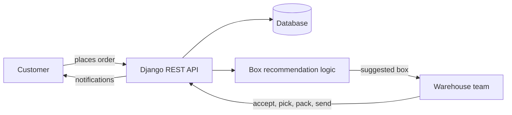
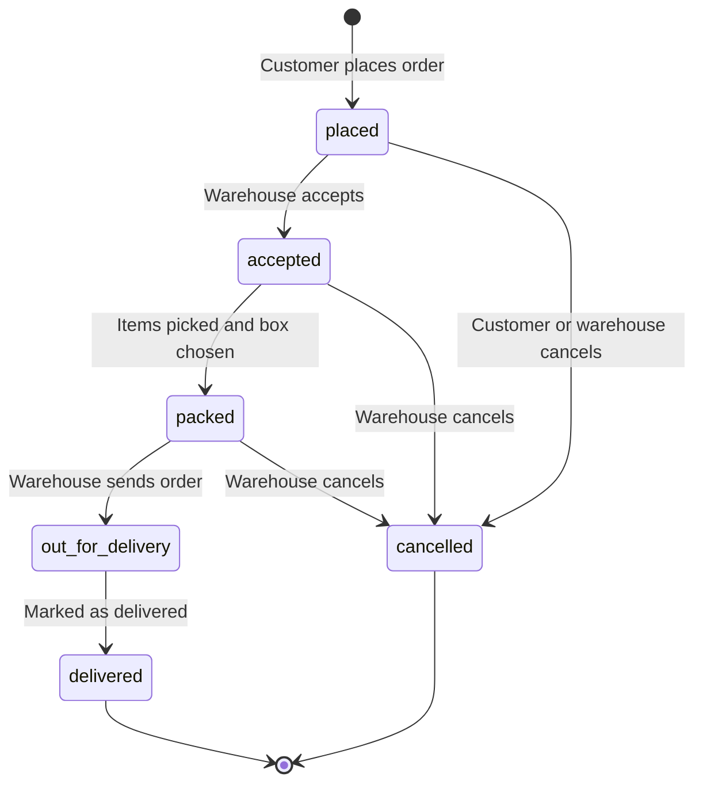
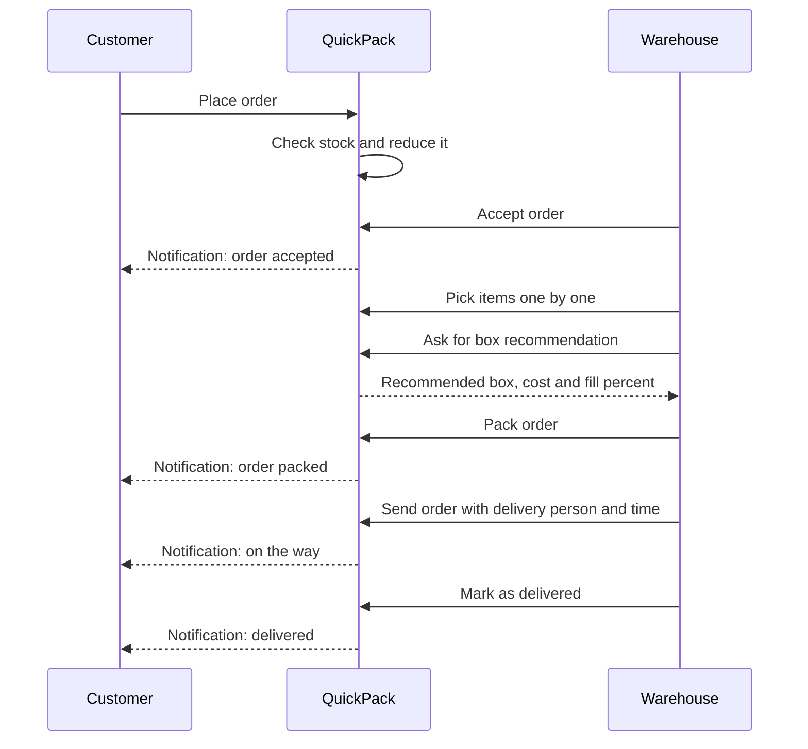
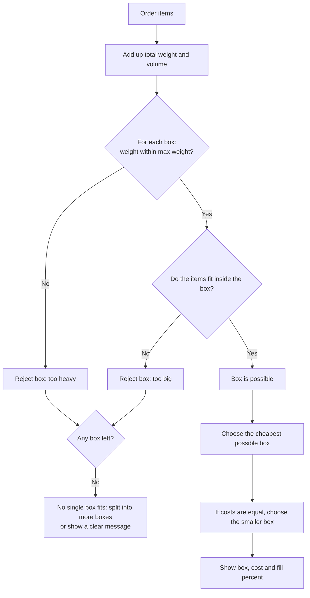

# QuickPack - Box Selection System

QuickPack is a small **Django** project for an e-commerce warehouse. When a customer places an order, the system **recommends the best shipping box** for the items. The warehouse team then accepts, picks, packs and sends the order, and the customer gets a notification at every step.

**Built by:** Vaishnavi Manik Kale

---

## Table of Contents

1. [The problem](#1-the-problem)
2. [Main features](#2-main-features)
3. [How the system works (flow diagrams)](#3-how-the-system-works-flow-diagrams)
4. [How the box is chosen](#4-how-the-box-is-chosen)
5. [Tech stack](#5-tech-stack)
6. [Project structure](#6-project-structure)
7. [Setup and run commands](#7-setup-and-run-commands)
8. [Running the tests](#8-running-the-tests)
9. [Main API endpoints](#9-main-api-endpoints)
10. [Sample demo data](#10-sample-demo-data)
11. [Known issues](#11-known-issues)
12. [Other files in this repository](#12-other-files-in-this-repository)

---

## 1. The problem

Every product has a **length, width, height and weight**. Every box has **internal dimensions, a maximum weight and a cost**. The warehouse needs to know:

> "Which box should I use for this order?"

QuickPack answers this automatically, so the warehouse does not have to guess.

---

## 2. Main features

**Customer**
- Browse the shop and see prices and offers
- Add items to the cart and place an order
- Stock check: a customer cannot order more than the stock available
- Track orders and see the delivery person and estimated time
- Cancel an order before the warehouse accepts it
- Wishlist, notifications, support tickets and payment preference
- Request a product that is not in the shop

**Warehouse**
- See all orders and low-stock products
- Accept an order, pick items, get a **box recommendation**, and pack
- Send the order with a delivery person's name, phone number and delivery time
- Mark an order as delivered, or cancel it
- Mark an item as not available
- Add products, restock, set price and offer, upload product photos
- Review customer item requests and reply to support tickets

---

## 3. How the system works (flow diagrams)

### 3.1 Overall system



### 3.2 Order life cycle



Rules that are enforced:
- The customer can cancel **only while the order is `placed`**.
- An order cannot be packed before it is accepted, and cannot be sent before it is packed.
- The warehouse cannot cancel an order that is out for delivery, delivered or already cancelled.
- If every item in an order becomes unavailable, the order is cancelled automatically.

### 3.3 Step-by-step flow (who does what)



---

## 4. How the box is chosen



In simple words:
1. Add up the weight and size of all items in the order.
2. Throw away every box that is too small or cannot carry the weight.
3. From the boxes that are left, pick the **cheapest** one (not just the smallest).
4. Show the **fill percent** so the warehouse sees how full the box is.

Extra rules covered by the automated tests:
- Items can be **rotated** to fit.
- **Fragile** items are not packed together with heavy items.
- If one box cannot hold everything, the order can be **split into several boxes** (this can be switched off).
- If an item is bigger than every box, the system says so clearly.

> Note: the demo screen (`quickpack-demo.html`) uses a simplified rule: items fit if their total volume is at most 80% of the box volume.

---

## 5. Tech stack

| Part | Technology |
|---|---|
| Language | Python 3.11 |
| Framework | Django 5.2 |
| Image upload | Pillow |
| Database | SQLite (default Django database) |
| Front end | HTML, CSS and JavaScript screens for the customer and warehouse workspaces |

---

## 6. Project structure

```
QuickPack/
├── manage.py
├── requirements.txt            # Django, Pillow
├── boxsystem/                  # Django project settings
│   └── settings.py
├── packing/                    # Main app
│   ├── models.py               # Box, Product, Order, OrderItem, CustomerProfile,
│   │                           # ProductRequest, Recommendation, SupportTicket,
│   │                           # UserNotification, WishlistItem
│   ├── tests.py                # Box logic, API, stock, picking tests
│   ├── tests_send.py           # Send, deliver, cancel, photo, login tests
│   └── management/commands/
│       └── seed_demo.py        # Loads the demo shop products
├── quickpack-demo.html         # Standalone demo of the screens with sample data
├── README.md
├── AI_USAGE.md
├── TEST_CASES.md
└── TEST_OUTPUT.md
```

---

## 7. Setup and run commands

### Windows (Command Prompt)

```bash
# 1. Go to the project folder
cd QuickPack

# 2. Create a virtual environment
python -m venv venv

# 3. Activate it
venv\Scripts\activate

# 4. Install the requirements
pip install -r requirements.txt

# 5. Create the database tables
python manage.py migrate

# 6. Load the demo products
python manage.py seed_demo

# 7. Start the server
python manage.py runserver
```

### Mac / Linux

```bash
cd QuickPack
python3 -m venv venv
source venv/bin/activate
pip install -r requirements.txt
python manage.py migrate
python manage.py seed_demo
python manage.py runserver
```

Now open **http://127.0.0.1:8000/** in your browser. Stop the server with `CTRL + C` (or `CTRL + BREAK` on Windows).

To create an admin user (optional):

```bash
python manage.py createsuperuser
```

To try only the screens without running Django, open `quickpack-demo.html` in a browser. It uses built-in sample data.

---

## 8. Running the tests

```bash
# Run all tests with details
python manage.py test -v 2

# Run one test file
python manage.py test packing.tests
python manage.py test packing.tests_send

# Run one test class
python manage.py test packing.tests.RecommendLogicTests
```

**Latest result:** 88 tests ran, 56 passed, 7 failed, 25 errors. See [Known issues](#11-known-issues) and `TEST_OUTPUT.md`.

The manual test cases (steps and expected results) are in `TEST_CASES.md`.

---

## 9. Main API endpoints

| Method | Endpoint | What it does |
|---|---|---|
| GET | `/api/products/` | List shop products with price and stock |
| POST | `/api/products/add/` | Warehouse adds a new product |
| POST | `/api/orders/place/` | Customer places an order |
| GET | `/api/my-orders/` | Customer sees own orders |
| POST | `/api/orders/<id>/cancel/` | Customer cancels a placed order |
| POST | `/api/orders/<id>/accept/` | Warehouse accepts an order |
| POST | `/api/orders/<id>/items/<item_id>/pick/` | Warehouse marks items as picked |
| POST | `/api/orders/<id>/items/<item_id>/unavailable/` | Mark an item as not available |
| GET | `/api/orders/<id>/recommend-box/` | Get the recommended box |
| POST | `/api/orders/<id>/pack/` | Pack the order in the chosen box |
| POST | `/api/warehouse/orders/<id>/send/` | Send the order with delivery details |
| POST | `/api/warehouse/orders/<id>/deliver/` | Mark the order as delivered |
| POST | `/api/warehouse/orders/<id>/cancel/` | Warehouse cancels an order |
| POST | `/api/requests/place/` | Customer requests a new product |
| POST | `/api/support/` | Customer creates a support ticket |
| GET | `/api/notifications/` | Customer reads notifications |

Example: place an order

```json
POST /api/orders/place/
{
  "customer_name": "Aarav",
  "items": [
    { "product_id": 1, "quantity": 2 },
    { "product_id": 2, "quantity": 1 }
  ]
}
```

Common error messages: `Order has no items`, `Notebook: only 40 left`, `Order already accepted`, `Pack the order before sending it out`.

---

## 10. Sample demo data

**Boxes**

| Box | Size (cm) | Max weight | Cost |
|---|---|---|---|
| Small | 20 x 15 x 10 | 2 kg | Rs 8 |
| Medium | 30 x 20 x 15 | 5 kg | Rs 18 |
| Large | 45 x 30 x 25 | 12 kg | Rs 35 |

**Products:** `seed_demo` loads 12 shop products, for example Notebook, Water bottle, Coffee mug, Desk lamp, Backpack, Wireless mouse, Keyboard, Headphones, Phone stand, Tiffin box, Yoga mat and Table fan.

**Example recommendations**

| Order | Result |
|---|---|
| Notebook x3 | Small box, cost 8, about 63% full |
| Notebook x2 + Water bottle x1 | Medium box, cost 18, about 28% full |
| Backpack + Wireless mouse x2 + Tiffin box | Large box, cost 35, about 59% full |

---

## 11. Known issues

I ran 88 tests: **56 passed, 7 failed and 25 had errors**. I found the reasons and I am fixing them:

1. **`ALLOWED_HOSTS`**: `'testserver'` is missing, so the 4 login workspace tests fail with status 400.
2. **Demo data clashes with tests**: the tests expect their own 10 products (for example "Pen"), but `seed_demo` loads 12 shop products. This causes the `KeyError` errors and the `12 != 10` failure.
3. **Warnings**: `DEFAULT_AUTO_FIELD` is not set, so Django shows `models.W042` warnings. These are harmless.

---

## 12. Other files in this repository

| File | Purpose |
|---|---|
| `AI_USAGE.md` | Which AI tools I used, the prompts, what I accepted or changed, mistakes, and how I verified |
| `TEST_CASES.md` | All manual test cases with steps and expected results |
| `TEST_OUTPUT.md` | Terminal output of `python manage.py test -v 2` |
| `quickpack-demo.html` | Standalone demo of the customer and warehouse screens |